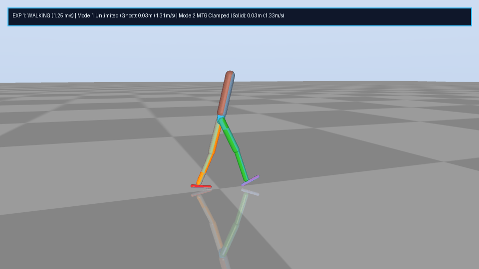
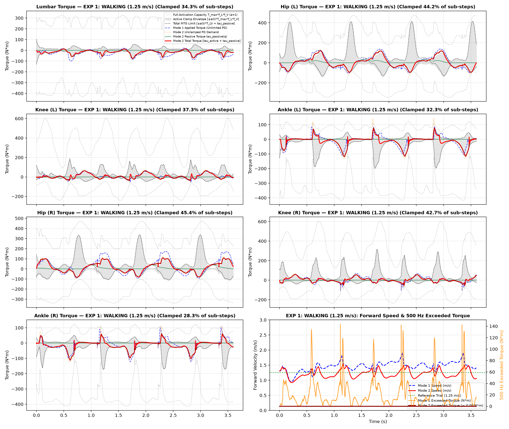
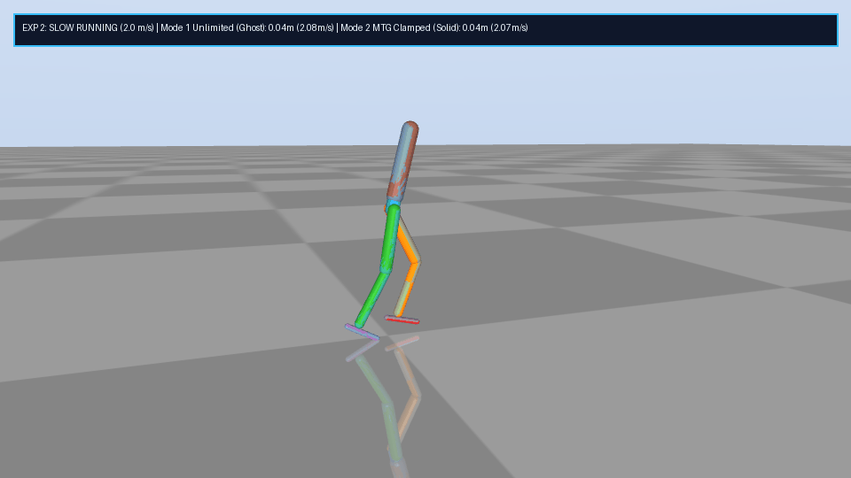
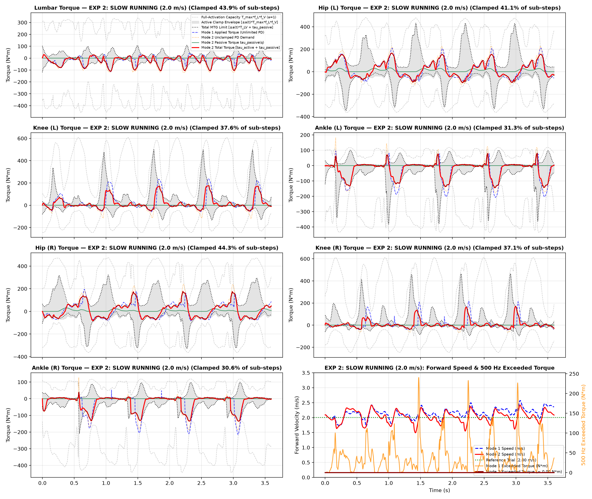
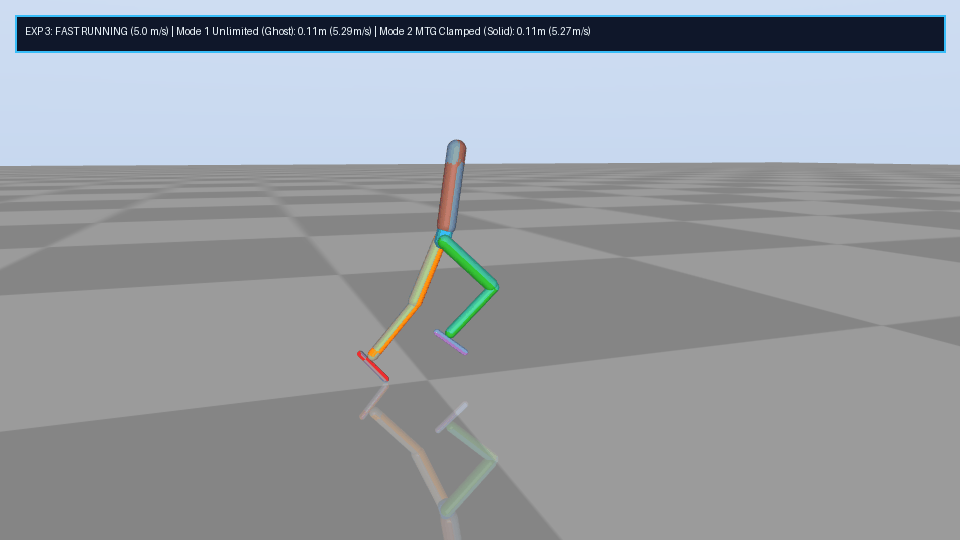
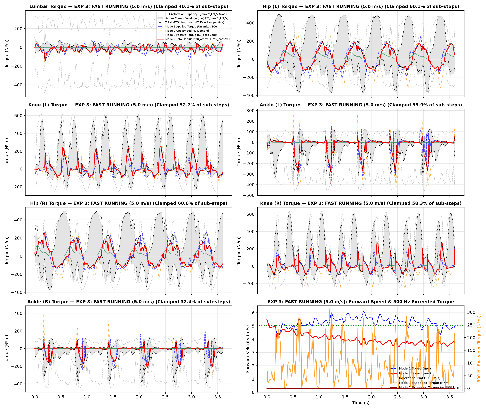

# 10-DoF Musculoskeletal Biped — MuJoCo Physics & 500 Hz MTG Actuators

A **MuJoCo + PyTorch** reinforcement learning framework for a 10-Degree-of-Freedom (10-DoF) sagittal-plane musculoskeletal biped comparing **Unconstrained Ideal PD Control (Mode 1)** against **Biologically Clamped Hill-Type Muscle Torque Generators (Mode 2)** across human walking, slow running (`2.0 m/s`), and fast sprinting (`5.0 m/s`).

---

## 📁 Repository Structure

```text
MTG_RL/
├── biped_10dof.xml                         # 10-DoF MuJoCo musculoskeletal biped model (500 Hz, dt = 0.002s)
├── biped_overlay.xml                       # Dual-biped overlay scene (Mode 1 Ghost vs Mode 2 Solid)
├── Biped_Actuators.py                      # Mode 1 (Unlimited PD) & Mode 2 (500 Hz Clamped MTG + Activation + Passive)
├── Biped_Env.py                            # Core 500 Hz MuJoCo simulation interface
├── Stable_Motion_Tracker.py                # Gated Residual Actor-Critic policy & two-phase MTG curriculum env
├── run_all_experiments.py                  # Unified training, 500 Hz verification, plotting & GIF rendering suite
├── motions/
│   ├── Arnold2013Walking_subject01_walk2.npz  # Experiment 1: Walking reference (~1.25 m/s)
│   ├── Hamner2013_Run20_cycle.npz             # Experiment 2: Slow running reference (2.0 m/s)
│   └── Hamner2013_Run50_cycle.npz             # Experiment 3: Fast running reference (5.0 m/s)
├── checkpoints/
│   ├── exp1_walk_mode1.pt                  # Exp 1 Walking — Mode 1 (Unlimited PD)
│   ├── exp1_walk_mode2.pt                  # Exp 1 Walking — Mode 2 (MTG Clamped)
│   ├── exp2_run20_mode1.pt                 # Exp 2 Slow Running (2 m/s) — Mode 1 (Unlimited PD)
│   ├── exp2_run20_mode2.pt                 # Exp 2 Slow Running (2 m/s) — Mode 2 (MTG Clamped)
│   ├── exp3_run50_mode1.pt                 # Exp 3 Fast Running (5 m/s) — Mode 1 (Unlimited PD)
│   └── exp3_run50_mode2.pt                 # Exp 3 Fast Running (5 m/s) — Mode 2 (MTG Clamped)
├── renders/
│   ├── exp1_walking_overlay.gif
│   ├── exp1_walking_torque_limits.png
│   ├── exp2_slow_running_2ms_overlay.gif
│   ├── exp2_slow_running_2ms_torque_limits.png
│   ├── exp3_fast_running_5ms_overlay.gif
│   └── exp3_fast_running_5ms_torque_limits.png
└── requirements.txt
```

---

## ⚙️ Actuator Formulation (`500 Hz` Sub-Step Physics)

The RL policy outputs residual joint angle targets at `50 Hz` (`10` physics sub-steps per policy step), while PD tracking, muscle activation integration, and MTG torque clamping execute at every **`500 Hz` ($\Delta t_{\text{sim}} = 0.002\text{ s}$) MuJoCo physics sub-step**.

### Mode 1: Ideal Unlimited PD (`IdealUnlimitedActuator`)
Direct linear joint PD control with no biological torque envelopes:
$$\tau_{\text{pd}} = K_p \left(q_{\text{des}} - q\right) + K_d \left(\dot{q}_{\text{des}} - \dot{q}\right)$$

### Mode 2: 500 Hz Clamped Hill-Type MTG (`MTGClampedActuator`)
At each `0.002s` physics sub-step:

1. **Non-Linear Passive Joint Restoring Torque**:
   $$\tau_{\text{passive}}(q) = k_1 \max(0,\, q_1 - q)^2 - k_2 \max(0,\, q - q_2)^2$$
2. **Active Torque Compensation for Passive Torque**:
   $$\tau_{\text{active,des}} = \tau_{\text{pd}} - \tau_{\text{passive}}(q)$$
3. **Force-Length & Force-Velocity Kinematic Capacity ($a = 1$)**:
   $$T_{LV}^\pm(q, \dot{q}) = T_{\max}^\pm \cdot f_L(q) \cdot f_V^\pm(\dot{q})$$
4. **1st-Order Muscle Activation Dynamics $a(t)$** ($\tau_{\text{act}} = 20\text{ ms}$, $\tau_{\text{deact}} = 40\text{ ms}$, $a_{\min} = 0.01$):
   $$u_{\text{req}} = \text{clamp}\!\left(\frac{|\tau_{\text{active,des}}|}{T_{LV}^{\text{dir}}(q, \dot{q}) + 10^{-3}},\ 0.0,\ 1.0\right), \qquad \dot{a} = \begin{cases} \dfrac{u_{\text{req}} - a}{\tau_{\text{act}}}, & u_{\text{req}} \ge a \\[8pt] \dfrac{u_{\text{req}} - a}{\tau_{\text{deact}}}, & u_{\text{req}} < a \end{cases}$$
5. **Instantaneous `500 Hz` Active Torque Clamping & Total Torque Application**:
   $$\tau_{\text{active}} = \text{clamp}\!\left(\tau_{\text{active,des}},\ -a(t)\,T_{LV}^-(q, \dot{q}),\ +a(t)\,T_{LV}^+(q, \dot{q})\right)$$
   $$\tau_{\text{total}} = \tau_{\text{active}} + \tau_{\text{passive}}(q)$$

### Two-Phase MTG Curriculum
1. **Mode 1 Baseline**: Train unconstrained PD imitation policy.
2. **Mode 2 — Phase 1 (Soft MTG Penalty)**: Warm-start from Mode 1 and penalize normalized sub-step MTG excess in the reward to guide joint trajectories into high-$f_L \cdot f_V$ regions.
3. **Mode 2 — Phase 2 (Hard `500 Hz` MTG Clamping)**: Enforce strict physical clamping on $\tau_{\text{active}}$ at every `0.002s` physics sub-step (`0.000000 N*m` violation).

---

## 📊 Experimental Results (`180/180` Steps, `3.60s`, `1,800` Sub-Steps at `500 Hz`)

| Experiment | Reference Trial | Mode | Survival (`180` steps) | Distance (`m`) | Mean Speed (`m/s`) | Mean `500 Hz` Exceeded Torque (`N*m`) | Max `500 Hz` Exceeded Torque (`N*m`) |
| :--- | :--- | :--- | :---: | :---: | :---: | :---: | :---: |
| **1. Walking** (`1.25 m/s`) | `Arnold2013Walking_subject01_walk2.npz` | **Mode 1** (Unlimited) | `180/180` (`Fell=False`) | `5.26 m` | `1.46 m/s` | `22.22 N*m` | `143.79 N*m` |
| | | **Mode 2** (MTG Clamped) | `180/180` (`Fell=False`) | `4.40 m` | `1.22 m/s` | **`0.000000 N*m`** | **`0.000000 N*m`** |
| **2. Slow Running** (`2.0 m/s`) | `Hamner2013_Run20_cycle.npz` | **Mode 1** (Unlimited) | `180/180` (`Fell=False`) | `7.70 m` | `2.14 m/s` | `37.94 N*m` | `240.51 N*m` |
| | | **Mode 2** (MTG Clamped) | `180/180` (`Fell=False`) | `7.30 m` | `2.03 m/s` | **`0.000000 N*m`** | **`0.000000 N*m`** |
| **3. Fast Running** (`5.0 m/s`) | `Hamner2013_Run50_cycle.npz` | **Mode 1** (Unlimited) | `180/180` (`Fell=False`) | `18.92 m` | `5.26 m/s` | `97.55 N*m` | `309.99 N*m` |
| | | **Mode 2** (MTG Clamped) | `180/180` (`Fell=False`) | `14.48 m` | `4.02 m/s` | **`0.000000 N*m`** | **`0.000000 N*m`** |

---

## 🏃‍♂️ Experiment 1: Walking Imitation (`1.25 m/s`)

Both Mode 1 (translucent blue ghost) and Mode 2 (solid musculoskeletal model) sustain stable walking at `~1.22–1.46 m/s`. In Mode 2, active clamping engages during ankle plantarflexion push-off and hip extension (`28–45%` of sub-steps) with zero envelope violations.





---

## 🏃 Experiment 2: Slow Running Imitation (`2.0 m/s`)

At `2.0 m/s`, Mode 2 matches the reference speed (`2.03 m/s` over `7.30 m`) while clamping high-frequency impact and push-off spikes (`up to 122.3 N*m` clipped at the ankle) strictly inside the dynamic $\pm a(t) T_{LV} + \tau_{\text{passive}}(q)$ envelope.





---

## ⚡ Experiment 3: Fast Running Imitation (`5.0 m/s`)

At `5.0 m/s`, Mode 1 sustains `5.26 m/s` (`18.92 m`) only by violating biological MTG torque limits by an average of `97.55 N*m` (peaking at `309.99 N*m` across joints). When hard-clamped at `500 Hz` in Mode 2 (`60%` of hip sub-steps and `53–58%` of knee sub-steps saturated, clipping spikes up to `377.8 N*m`), the musculoskeletal biped remains dynamically stable for all `180/180` steps (`14.48 m`) and settles to its biologically feasible top running speed of **`4.02 m/s`** with **`0.000000 N*m`** torque violation.





---

## 🚀 Running the Suite

To run or re-render all three experiments (loads existing checkpoints in `checkpoints/` or trains from scratch if removed):

```bash
python run_all_experiments.py
```
