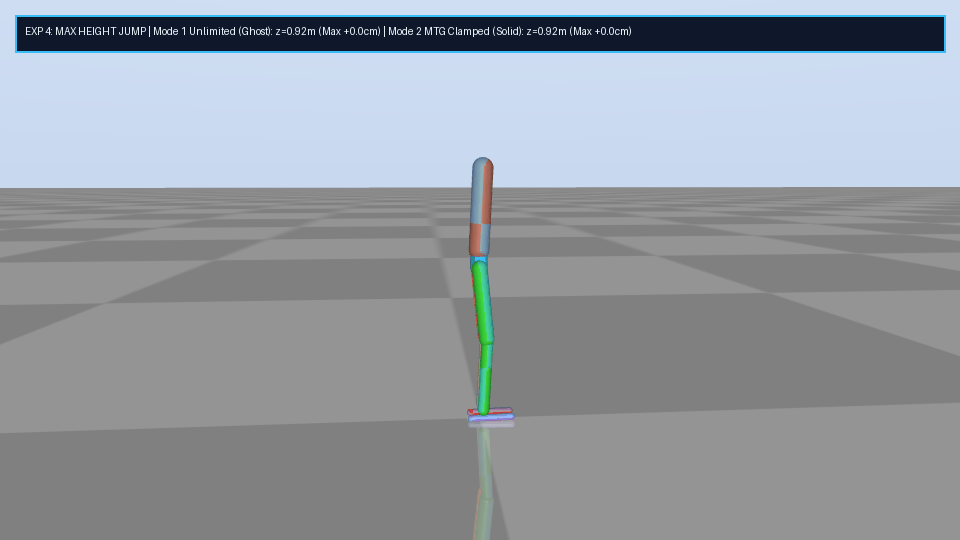
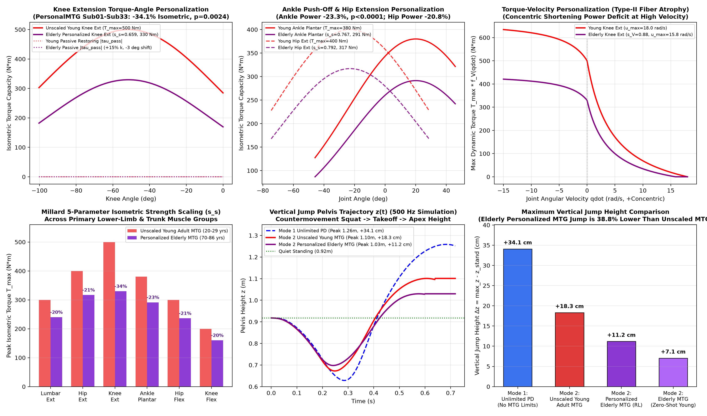
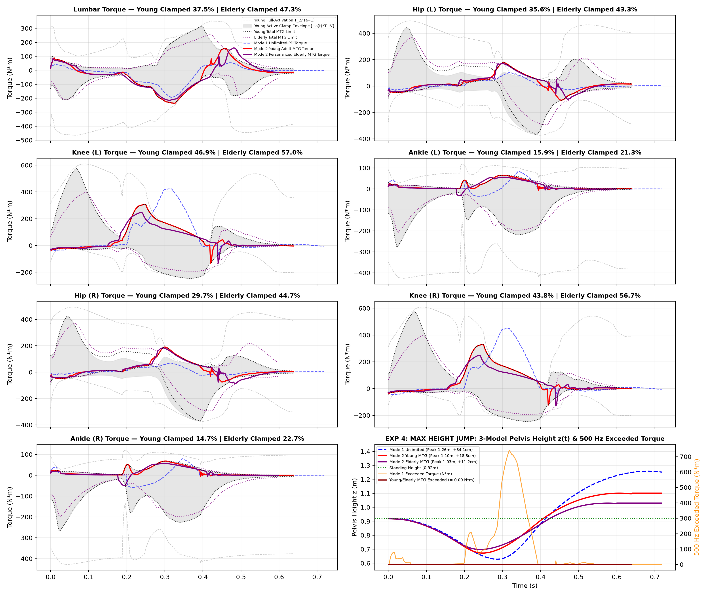

# 10-DoF Musculoskeletal Biped — MuJoCo Physics & 500 Hz MTG Actuators

A **MuJoCo + PyTorch** reinforcement learning framework for a 10-Degree-of-Freedom (10-DoF) sagittal-plane musculoskeletal biped comparing **Unconstrained Ideal PD Control (Mode 1)** against **Biologically Clamped Hill-Type Muscle Torque Generators (Mode 2 — Unscaled Young Adult & Personalized Elderly Adult)** across human walking (`1.25 m/s`), slow running (`2.0 m/s`), fast sprinting (`5.0 m/s`), and **pure RL motion generation for a Maximum Height Vertical Jump** (no reference trial to imitate).

---

## 📁 Repository Structure

```text
MTG_RL/
├── biped_10dof.xml                         # 10-DoF MuJoCo musculoskeletal biped model (500 Hz, dt = 0.002s)
├── biped_overlay.xml                       # Dual-biped overlay scene (Mode 1 Ghost vs Mode 2 Solid)
├── biped_overlay_jump.xml                  # 3-biped side-by-side scene (Mode 1 vs Young MTG vs Elderly MTG)
├── Biped_Actuators.py                      # Mode 1 (Unlimited PD), Mode 2 (Young MTG), & Mode 2 Elderly MTG
├── Biped_Env.py                            # Core 500 Hz MuJoCo simulation interface
├── Stable_Motion_Tracker.py                # Gated Residual Actor-Critic policy & two-phase MTG curriculum env
├── run_all_experiments.py                  # Unified training, 500 Hz verification, plotting & GIF rendering suite
├── personal_mtg/                           # Millard et al. (2019) 5-Parameter MTG Personalization & Scaling Package
│   ├── __init__.py
│   ├── spline_factory.py                   # C2 smooth B-spline curves (Active Torque-Angle, Torque-Velocity, Passive)
│   ├── torque_muscle.py                    # MillardTorqueMuscle (5-param scaling: s^A, s^V, Delta^P, lambda^P, s^s)
│   ├── lower_limb_models.py                # Standard lower-limb MTG definitions (Hip, Knee, Ankle Ext/Flex)
│   ├── muscle_fitting.py                   # MuscleFittingOptimizer (SLSQP constrained QP personalization engine)
│   ├── opensim_loader.py                   # OpenSim .mot/.sto loader & torque outlier filtering
│   ├── visualization.py                    # Diagnostic MTG curve & activation feasibility plots
│   ├── elderly_personalizer.py             # Elderly Adult vs Young Adult cohort MTG scaling pipeline
│   └── data/
│       ├── stats_young_vs_elderly.csv      # Elderly (n=33, 70-86 yrs) vs Young (n=25, 20-29 yrs) stats
│       ├── population_features.csv         # Per-subject demographic, kinematic, and kinetic features
│       └── population_trajectories.npz     # Normalized gait cycle angle & moment trajectories
├── motions/
│   ├── Arnold2013Walking_subject01_walk2.npz  # Experiment 1: Walking reference (~1.25 m/s)
│   ├── Hamner2013_Run20_cycle.npz             # Experiment 2: Slow running reference (2.0 m/s)
│   └── Hamner2013_Run50_cycle.npz             # Experiment 3: Fast running reference (5.0 m/s)
├── checkpoints/
│   ├── exp1_walk_mode1.pt                  # Exp 1 Walking — Mode 1 (Unlimited PD)
│   ├── exp1_walk_mode2.pt                  # Exp 1 Walking — Mode 2 (MTG Clamped)
│   ├── exp2_run20_mode1.pt                 # Exp 2 Slow Running (2 m/s) — Mode 1 (Unlimited PD)
│   ├── exp2_run20_mode2.pt                 # Exp 2 Slow Running (2 m/s) — Mode 2 (MTG Clamped)
│   ├── exp3_run50_mode1.pt                 # Exp 3 Fast Running (5 m/s) — Mode 1 (Unlimited PD)
│   ├── exp3_run50_mode2.pt                 # Exp 3 Fast Running (5 m/s) — Mode 2 (MTG Clamped)
│   ├── exp4_jump_mode1.pt                  # Exp 4 Max Height Jump (Pure RL) — Mode 1 (Unlimited PD)
│   ├── exp4_jump_mode2.pt                  # Exp 4 Max Height Jump (Pure RL) — Mode 2 (Unscaled Young MTG)
│   └── exp4_jump_mode2_elderly.pt          # Exp 4 Max Height Jump (Pure RL) — Mode 2 (Personalized Elderly MTG)
├── renders/
│   ├── exp1_walking_overlay.gif
│   ├── exp1_walking_torque_limits.png
│   ├── exp2_slow_running_2ms_overlay.gif
│   ├── exp2_slow_running_2ms_torque_limits.png
│   ├── exp3_fast_running_5ms_overlay.gif
│   ├── exp3_fast_running_5ms_torque_limits.png
│   ├── exp4_max_jump_overlay.gif
│   ├── exp4_max_jump_torque_limits.png
│   └── exp4_elderly_mtg_personalization.png
└── requirements.txt
```

---

## ⚙️ Actuator Formulation (`500 Hz` Sub-Step Physics)

The RL policy outputs residual joint angle targets at `50 Hz` (`10` physics sub-steps per policy step), while PD tracking, muscle activation integration, and MTG torque clamping execute at every **`500 Hz` ($\Delta t_{\text{sim}} = 0.002\text{ s}$) MuJoCo physics sub-step**.

### Mode 1: Ideal Unlimited PD (`IdealUnlimitedActuator`)
Direct linear joint PD control with no biological torque envelopes:
$$\tau_{\text{pd}} = K_p \left(q_{\text{des}} - q\right) + K_d \left(\dot{q}_{\text{des}} - \dot{q}\right)$$

### Mode 2: 500 Hz Clamped Hill-Type MTG (`MTGClampedActuator`)
At each `0.002s` physics sub-step:

1. **Non-Linear Passive Joint Restoring Torque**:
   $$\tau_{\text{passive}}(q) = k_1 \max(0,\, q_1 - q)^2 - k_2 \max(0,\, q - q_2)^2$$
2. **Active Torque Compensation for Passive Torque**:
   $$\tau_{\text{active,des}} = \tau_{\text{pd}} - \tau_{\text{passive}}(q)$$
3. **Force-Length & Force-Velocity Kinematic Capacity ($a = 1$)**:
   $$T_{LV}^\pm(q, \dot{q}) = T_{\max}^\pm \cdot f_L(q) \cdot f_V^\pm(\dot{q})$$
4. **1st-Order Muscle Activation Dynamics $a(t)$** ($\tau_{\text{act}} = 20\text{ ms}$, $\tau_{\text{deact}} = 40\text{ ms}$, $a_{\min} = 0.01$):
   $$u_{\text{req}} = \text{clamp}\!\left(\frac{|\tau_{\text{active,des}}|}{T_{LV}^{\text{dir}}(q, \dot{q}) + 10^{-3}},\ 0.0,\ 1.0\right), \qquad \dot{a} = \begin{cases} \dfrac{u_{\text{req}} - a}{\tau_{\text{act}}}, & u_{\text{req}} \ge a \\[8pt] \dfrac{u_{\text{req}} - a}{\tau_{\text{deact}}}, & u_{\text{req}} < a \end{cases}$$
5. **Instantaneous `500 Hz` Active Torque Clamping & Total Torque Application**:
   $$\tau_{\text{active}} = \text{clamp}\!\left(\tau_{\text{active,des}},\ -a(t)\,T_{LV}^-(q, \dot{q}),\ +a(t)\,T_{LV}^+(q, \dot{q})\right)$$
   $$\tau_{\text{total}} = \tau_{\text{active}} + \tau_{\text{passive}}(q)$$

---

## 🧬 Millard et al. (2019) 5-Parameter MTG Personalization (`personal_mtg/`)

The [`personal_mtg/`](file:///c:/Users/anbes/OneDrive/Desktop/MTG_RL/personal_mtg) package implements the **Millard et al. (2019)** (*J. Biomechanics* 89:11–20) 5-parameter Muscle-Torque-Generator personalization method and clinical cohort scaling pipeline:

### 1. 5-Parameter MTG Scaling Formulation (`personal_mtg/torque_muscle.py`)
Each [`MillardTorqueMuscle`](file:///c:/Users/anbes/OneDrive/Desktop/MTG_RL/personal_mtg/torque_muscle.py) transforms its $C^2$-smooth characteristic curves (`ActiveTorqueAngleCurve`, `TorqueVelocityCurve`, `PassiveTorqueAngleCurve` in [`personal_mtg/spline_factory.py`](file:///c:/Users/anbes/OneDrive/Desktop/MTG_RL/personal_mtg/spline_factory.py)) via the 5-parameter vector $\mathbf{x} = \left[s^A,\, s^V,\, \Delta^P,\, \lambda^P,\, s^s\right]^T$:

$$\tau^M(a, \theta, \omega; \mathbf{x}) = s^s \tau_o^M \left[ a \cdot t^A(\theta; s^A) \cdot t^V(\omega; s^V) + t^{PE}(\theta; \Delta^P, \lambda^P)\left(1 - \beta^{PE} \frac{\omega}{s^V \omega_{\max}^M}\right) \right]$$

where:
- **$s^A$ (Active Torque-Angle Width Scale)**: $\theta_{\text{eff}} = \frac{\theta - \theta_o}{s^A} + \theta_o$
- **$s^V$ (Maximum Angular Velocity Scale)**: $\omega_{\text{eff}} = \frac{\omega}{s^V}$
- **$\Delta^P, \lambda^P$ (Passive Angle Shift & Stiffness Scale)**: $t^{PE}(\theta; \Delta^P, \lambda^P) = (1 - \lambda^P)\,t_o^{PE}(\theta - \Delta^P)$
- **$s^s$ (Isometric Strength Scale)**: Scales peak isometric torque capacity $\tau_o^M \rightarrow s^s \tau_o^M$

### 2. Constrained QP / SLSQP Fitting Engine (`personal_mtg/muscle_fitting.py`)
Given experimental joint kinematics $(\theta(t), \omega(t))$ and inverse-dynamics joint moments $\tau_{\text{exp}}(t)$, [`MuscleFittingOptimizer`](file:///c:/Users/anbes/OneDrive/Desktop/MTG_RL/personal_mtg/muscle_fitting.py) solves:

$$\min_{\mathbf{x}} \ (\mathbf{x} - \bar{\mathbf{x}})^T \mathbf{W} (\mathbf{x} - \bar{\mathbf{x}}) \qquad \text{subject to:} \quad \begin{cases} \tau^M(a_{\max}, \theta_k, \omega_k; \mathbf{x}) \ge \tau_{\text{exp},k} & \text{(Active capacity feasibility)} \\ \tau_{\text{exp},k} \ge \tau^M(0, \theta_k, \omega_k; \mathbf{x}) & \text{(Passive torque bound, } a_k \ge 0\text{)} \\ t^{PE}(\theta_k; \Delta^P, \lambda^P) \le t_{\max}^{PE} & \text{(Passive strain limit)} \end{cases}$$

### 3. Elderly Adult vs. Young Adult Cohort Personalization (`personal_mtg/elderly_personalizer.py`)
[`fit_elderly_population_mtg_scaling()`](file:///c:/Users/anbes/OneDrive/Desktop/MTG_RL/personal_mtg/elderly_personalizer.py) calibrates [`ElderlyMTGClampedActuator`](file:///c:/Users/anbes/OneDrive/Desktop/MTG_RL/Biped_Actuators.py) using the **Elderly Adult Biomechanics Cohort (`Sub01`–`Sub33`, $n=33$, ages 70–86 yrs, mean `77.8 ± 4.8 yrs`)** relative to the **Young Adult Reference Cohort (`Sub111`–`Sub138`, $n=25$, ages 20–29 yrs, mean `24.6 ± 2.4 yrs`)** stored in [`personal_mtg/data/stats_young_vs_elderly.csv`](file:///c:/Users/anbes/OneDrive/Desktop/MTG_RL/personal_mtg/data/stats_young_vs_elderly.csv), [`personal_mtg/data/population_features.csv`](file:///c:/Users/anbes/OneDrive/Desktop/MTG_RL/personal_mtg/data/population_features.csv), and [`personal_mtg/data/population_trajectories.npz`](file:///c:/Users/anbes/OneDrive/Desktop/MTG_RL/personal_mtg/data/population_trajectories.npz):

| Muscle / Joint Group | Cohort Biomechanical Finding (`Elderly` vs. `Young`) | $s^s$ (Strength) | $s^A$ (ROM Width) | $s^V$ (Max Velocity) | $\Delta^P$ (Passive Shift) | Unscaled $T_{\max}$ $\rightarrow$ Elderly $T_{\max}$ |
| :--- | :--- | :---: | :---: | :---: | :---: | :---: |
| **Knee Extension** | Peak Ext Moment **`-34.1%`** ($p = 0.0024$) | **`0.659`** | `0.92` | `0.88` | `-3.0°` | `500.0 N*m` $\rightarrow$ **`329.6 N*m`** |
| **Ankle Plantarflexion** | Push-Off Power A2 **`-23.3%`** ($p < 0.0001$), Moment `-12.2%` | **`0.767`** | `0.95` | `0.90` | `-3.5°` | `380.0 N*m` $\rightarrow$ **`291.4 N*m`** |
| **Hip Extension** | Power Generation H3 **`-20.8%`** ($p = 0.0282$) | **`0.792`** | `0.94` | `0.90` | `0.0°` | `400.0 N*m` $\rightarrow$ **`316.9 N*m`** |
| **Hip Flexion** | Peak Flex Moment **`-21.3%`** ($p = 0.0128$) | **`0.787`** | `0.95` | `0.90` | `0.0°` | `300.0 N*m` $\rightarrow$ **`236.1 N*m`** |
| **Knee Flexion** | Sarcopenic hamstring scaling | **`0.800`** | `0.94` | `0.90` | `0.0°` | `200.0 N*m` $\rightarrow$ **`160.0 N*m`** |
| **Ankle Dorsiflexion** | Swing DF ROM `-66.9%` ($p = 0.0059$) | **`0.767`** | `0.95` | `0.90` | `0.0°` | `100.0 N*m` $\rightarrow$ **`76.7 N*m`** |
| **Lumbar Ext / Flex** | Trunk extensor/flexor aging scaling | **`0.800`** | `0.94` | `0.90` | `0.0°` | `300/400 N*m` $\rightarrow$ **`240/320 N*m`** |

In addition, [`ElderlyMTGClampedActuator`](file:///c:/Users/anbes/OneDrive/Desktop/MTG_RL/Biped_Actuators.py) includes `+15%` passive tissue stiffness ($k_1, k_2 \times 1.15$) and slower elderly excitation-contraction dynamics ($\tau_{\text{act}} = 24\text{ ms}$, $\tau_{\text{deact}} = 48\text{ ms}$).

---

## 📊 Experimental Results (`500 Hz` Verification)

| Experiment | Reference Trial | Mode | Survival | Distance / Apex Height | Speed / Peak $V_z$ | Mean `500 Hz` Exceeded Torque | Max `500 Hz` Exceeded Torque |
| :--- | :--- | :--- | :---: | :---: | :---: | :---: | :---: |
| **1. Walking** (`1.25 m/s`) | `Arnold2013Walking_subject01_walk2.npz` | **Mode 1** (Unlimited) | `180/180` (`Fell=False`) | `5.26 m` | `1.46 m/s` | `22.22 N*m` | `143.79 N*m` |
| | | **Mode 2** (MTG Clamped) | `180/180` (`Fell=False`) | `4.40 m` | `1.22 m/s` | **`0.000000 N*m`** | **`0.000000 N*m`** |
| **2. Slow Running** (`2.0 m/s`) | `Hamner2013_Run20_cycle.npz` | **Mode 1** (Unlimited) | `180/180` (`Fell=False`) | `7.70 m` | `2.14 m/s` | `37.94 N*m` | `240.51 N*m` |
| | | **Mode 2** (MTG Clamped) | `180/180` (`Fell=False`) | `7.30 m` | `2.03 m/s` | **`0.000000 N*m`** | **`0.000000 N*m`** |
| **3. Fast Running** (`5.0 m/s`) | `Hamner2013_Run50_cycle.npz` | **Mode 1** (Unlimited) | `180/180` (`Fell=False`) | `18.92 m` | `5.26 m/s` | `97.55 N*m` | `309.99 N*m` |
| | | **Mode 2** (MTG Clamped) | `180/180` (`Fell=False`) | `14.48 m` | `4.02 m/s` | **`0.000000 N*m`** | **`0.000000 N*m`** |
| **4. Max Height Jump** (Pure RL) | *None (Pure Motion Generation)* | **Mode 1** (Unlimited PD) | `36/36` (`Apex, Fell=False`) | `Peak z = 1.26 m` (**`+34.1 cm`**) | `Peak Vz = 3.24 m/s` | `89.47 N*m` | `742.15 N*m` |
| | | **Mode 2** (Unscaled Young MTG) | `32/32` (`Apex, Fell=False`) | `Peak z = 1.10 m` (**`+18.3 cm`**) | `Peak Vz = 2.22 m/s` | **`0.000000 N*m`** | **`0.000000 N*m`** |
| | | **Mode 2** (Personalized Elderly MTG — RL) | `30/30` (`Apex, Fell=False`) | `Peak z = 1.03 m` (**`+11.2 cm`**) | `Peak Vz = 1.73 m/s` | **`0.000000 N*m`** | **`0.000000 N*m`** |
| | | **Mode 2** (Elderly MTG — Zero-Shot Young Policy) | `30/30` (`Apex, Fell=False`) | `Peak z = 0.99 m` (**`+7.1 cm`**) | `Peak Vz = 1.76 m/s` | **`0.000000 N*m`** | **`0.000000 N*m`** |

---

## 🏃‍♂️ Experiment 1: Walking Imitation (`1.25 m/s`)

Both Mode 1 (translucent blue ghost) and Mode 2 (solid musculoskeletal model) sustain stable walking at `~1.22–1.46 m/s`. In Mode 2, active clamping engages during ankle plantarflexion push-off and hip extension (`28–45%` of sub-steps) with zero envelope violations.


---

## 🏃 Experiment 2: Slow Running Imitation (`2.0 m/s`)

At `2.0 m/s`, Mode 2 matches the reference speed (`2.03 m/s` over `7.30 m`) while clamping high-frequency impact and push-off spikes (`up to 122.3 N*m` clipped at the ankle) strictly inside the dynamic $\pm a(t) T_{LV} + \tau_{\text{passive}}(q)$ envelope.


---

## ⚡ Experiment 3: Fast Running Imitation (`5.0 m/s`)

At `5.0 m/s`, Mode 1 sustains `5.26 m/s` (`18.92 m`) only by violating biological MTG torque limits by an average of `97.55 N*m` (peaking at `309.99 N*m` across joints). When hard-clamped at `500 Hz` in Mode 2 (`60%` of hip sub-steps and `53–58%` of knee sub-steps saturated, clipping spikes up to `377.8 N*m`), the musculoskeletal biped remains dynamically stable for all `180/180` steps (`14.48 m`) and settles to its biologically feasible top running speed of **`4.02 m/s`** with **`0.000000 N*m`** torque violation.


---

## 🦘 Experiment 4: Maximum Height Vertical Jump — Mode 1 vs. Unscaled Young Adult MTG vs. Personalized Elderly Adult MTG

With **no reference trial to imitate**, the RL policy discovers an injury-free countermovement vertical jump from quiet standing (`z = 0.92 m`) purely by maximizing apex height (`max_z`) while respecting safe physiological joint range-of-motion bounds:

1. **Mode 1 (Ideal Unlimited PD — Left in GIF, Cyan)**:
   - Generates unbiological bilateral knee extension torques (`~445 N*m`) even at high concentric extension velocities, violating the Hill-type MTG envelope by an average of `89.47 N*m` (peaking at `742.15 N*m` across joints during push-off) to reach an apex of **`1.26 m` (`+34.1 cm` pelvis rise, `39.0 cm` foot clearance, `3.24 m/s` peak vertical velocity)**.
2. **Mode 2 (Unscaled Young Adult MTG — Center in GIF, Blue/Orange/Green)**:
   - As the hips, knees, and ankles rapidly extend during takeoff (`t = 0.22–0.42 s`), the concentric Force-Velocity hyperbola $f_V(\dot{q})$ narrows the active torque envelope $\pm a(t) T_{LV}(q, \dot{q})$. Active clamping engages on `43.8–46.9%` of knee sub-steps (clipping up to `333.8 N*m` of excess PD demand) and `29.7–35.6%` of hip sub-steps, launching the young adult musculoskeletal model to **`1.10 m` (`+18.3 cm` pelvis rise, `21.7 cm` foot clearance, `2.22 m/s` peak vertical velocity)** with **`0.000000 N*m`** torque violation.
3. **Mode 2 (Personalized Elderly Adult MTG — Right in GIF, Purple/Crimson/Gold)**:
   - Personalizing the MTG model to the **Elderly Adult cohort (`Sub01`–`Sub33`, ages 70–86 yrs from `personal_mtg/`)** reduces knee extension isometric capacity by `-34.1%` (`500` $\rightarrow$ `330 N*m`), ankle plantarflexion by `-23.3%` (`380` $\rightarrow$ `291 N*m`), hip extension by `-20.8%` (`400` $\rightarrow$ `317 N*m`), and maximum shortening velocity by `-10% to -12%`.
   - When the unscaled Young Adult jump policy is evaluated **zero-shot** on the personalized Elderly MTG body, jump height drops from `+18.3 cm` to **`+7.1 cm` (`0.99 m` apex, `-61.2%`)** because the deeper countermovement (`min_z = 0.67 m`) overwhelms the weakened elderly knee extensors.
   - When re-optimized via RL specifically for the personalized Elderly MTG capabilities (`checkpoints/exp4_jump_mode2_elderly.pt`), the policy adapts by choosing a **shallower, safer countermovement crouch (`min_z = 0.70 m` vs `0.67 m`)** and earlier hip/ankle coordination, recovering jump height to **`+11.2 cm` (`1.03 m` apex, `15.2 cm` foot clearance, `1.73 m/s` peak vertical velocity)** with **`0.000000 N*m`** violation — **38.8% lower than the unscaled Young Adult MTG model (`+18.3 cm`)**.







---

## 🚀 Running the Suite

To run or re-render all four experiments (loads existing checkpoints in `checkpoints/` or trains from scratch if removed):

```bash
python run_all_experiments.py
```

To inspect the standalone Millard 5-parameter Elderly Adult MTG personalization directly in Python:

```python
from personal_mtg import fit_elderly_population_mtg_scaling
from Biped_Actuators import ElderlyMTGClampedActuator

scaling = fit_elderly_population_mtg_scaling()
actuator = ElderlyMTGClampedActuator(device="cpu")
print("Elderly Peak Isometric Torque (+):", actuator.T_max_pos_np)
print("Elderly Peak Isometric Torque (-):", actuator.T_max_neg_np)
```
